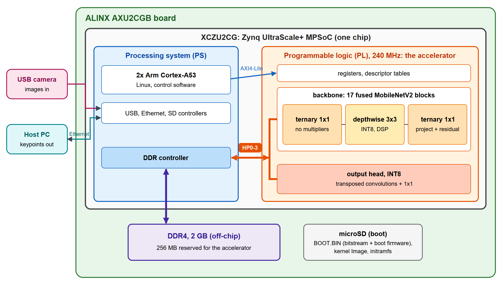
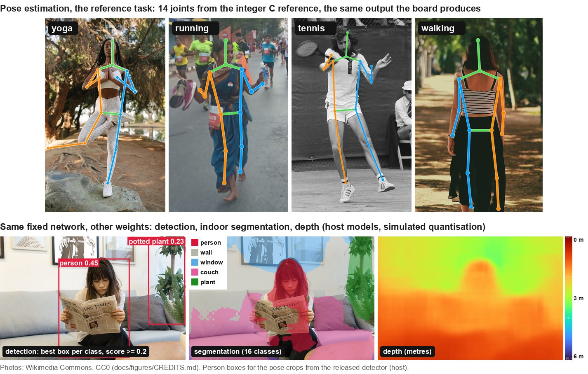

# zynq-ternary-mobilenet-codesign

A hardware/software co-design of a **ternary-weight MobileNetV2** on a Zynq UltraScale+ MPSoC: a fused,
row-streaming accelerator in the programmable logic and Linux control software on the ARM cores. The
hardware runs one fixed network shape; pose estimation, object detection, segmentation and depth are
different weights for it.

## The hardware

- **Board:** ALINX AXU2CGB ([product page](https://www.alinx.com/en/)) with an XCZU2CG Zynq UltraScale+
  MPSoC and 2 GB of DDR4; boots from microSD, reaches the host PC over Ethernet, reads a USB camera.
- **PL (programmable logic), 240 MHz:** all 17 MobileNetV2 backbone blocks fused into one row-streaming
  pipeline. The 34 pointwise and stem convolutions are **ternary** ({-1, 0, +1}: adder trees, no
  multipliers); depthwise convolutions and the transposed-convolution head are INT8.
- **PS (2x Arm Cortex-A53, Linux):** quantises the input, starts each frame through AXI4-Lite registers
  and reads the output; the accelerator moves its data to and from DDR itself over four HP ports.
- **Verified bit-exact:** the board's output equals an integer C reference on every byte.

## What it runs

Top: single-person pose, the reference task, computed by the integer C reference that the board
matches bit for bit. Bottom: detection, indoor segmentation and depth models trained for the same
fixed network, on an indoor photo, shown as host results (simulated quantisation; not yet run on the board). Photos are
CC0 from Wikimedia Commons ([credits](docs/figures/CREDITS.md)).

## Key numbers

| | value | measured on |
|---|---|---|
| Throughput | **228.7 fps** at 240 MHz | board, pose model, pipelined, mean of three 120-frame runs |
| Accuracy on the board | **PCKh@0.5 = 85.7**, MPII validation (2,289 people) | board output, byte-identical to the C reference on all 2,289 images |
| Cost of ternary weights | 1.89 PCKh points below the same recipe in INT8 (87.88 vs 85.99) | host, quantisation-aware models |
| FPGA resources | 93.3 % LUT, 96.7 % block RAM, 90.4 % DSP of the XCZU2CG | Vivado 2023.2, routed design |
| Power | 7.66 W, whole board | 12 V input, continuous inference, earlier bitstream of the same design |

Every number with its source entry and the full table: [docs/RESULTS.md](docs/RESULTS.md).

## Where to start

| I want to ... | start here |
|---|---|
| understand the architecture | [docs/DESIGN.md](docs/DESIGN.md), [docs/REPOSITORY.md](docs/REPOSITORY.md) |
| run it on the board | [docs/QUICKSTART.md](docs/QUICKSTART.md) |
| rebuild the bitstream or Linux | [docs/REBUILD.md](docs/REBUILD.md) |
| read the RTL | [rtl/](rtl/README.md) |
| train or export a model | [train/](train/README.md) |
| check correctness | [docs/VERIFICATION.md](docs/VERIFICATION.md) |
| see all results | [docs/RESULTS.md](docs/RESULTS.md) |
| know which datasets were used | [docs/DATASETS.md](docs/DATASETS.md) |

`ternpose` in file names such as `system_fuse_ternpose.bit` is the internal build name.

**License:** Apache 2.0 ([LICENSE](LICENSE), [NOTICE](NOTICE)); datasets are not included and keep their own terms ([docs/DATASETS.md](docs/DATASETS.md)).

**Citation:** see [CITATION.cff](CITATION.cff). Work done at the MIAT Laboratory, National Central University, Taiwan, advised by Dr. Ching-Han Chen.
