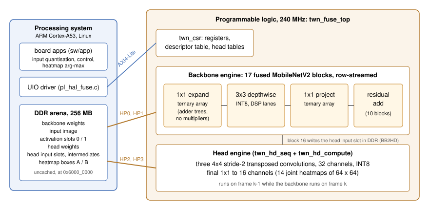

# zynq-ternary-mobilenet-codesign

A hardware/software co-design of a **ternary-weight MobileNetV2** on a Xilinx Zynq UltraScale+ MPSoC
(ALINX AXU2CGB board, XCZU2CG device). In the programmable logic (PL), a fused, row-streaming
accelerator written in Verilog runs all 17 backbone blocks and a 4-operator INT8 transposed-convolution
head at 240 MHz. On the ARM processing system (PS), Linux software quantises the input, controls each
frame through AXI4-Lite registers and post-processes the output. The 34 pointwise and stem
convolutions use ternary weights {-1, 0, +1}, so they need adders but no multipliers; the depthwise
convolutions and the head are INT8.

The hardware runs a fixed network shape (MobileNetV2 backbone, 32-channel head, 16 output channels);
a task is a set of weights and its post-processing. **Single-person pose estimation** is the reference
task, with full board results below. **Object detection, indoor scene segmentation and monocular
depth** models trained for the same fixed network are included, with host-side results. This
repository holds everything needed to rebuild the design from source: RTL and testbenches, the
bit-exact C reference, Vivado and PetaLinux build scripts, board software, and the training,
quantisation and export code. (`ternpose` in file names such as `system_fuse_ternpose.bit` is the
internal build name.)

## Results

Measured on the ALINX AXU2CGB board with the release bitstream (SHA-256 prefix `52b400785924efe0`,
inside `BOOT.BIN` `690d87cc5f4b6897`) and the deployed model `probe_tern_dc32` (see the
[glossary](#glossary)). Every number is copied from [`results/board_results.json`](results/board_results.json);
the last column names the entry.

| quantity | value | measured on / how | entry |
|---|---|---|---|
| Throughput | **228.7 fps** (runs: 228.73, 228.98, 228.42) | board, `mbv2_fuse_pipe`, three 120-frame runs, head in the PL, backbone-to-head direct write on (`FUSE_BB2HD=1`), 240 MHz | `thesis_model_probe_tern_dc32_board_20261012` |
| Throughput, direct write off | 223.7 fps (runs: 224.11, 223.46, 223.55) | same boot and bitstream, `FUSE_BB2HD=0` (the processor copies the head input) | same |
| Accuracy on the board | **PCKh@0.5 = 85.715** | the integer network on the board over all 2,289 instances of the MPII validation split, 14 joints; all 2,289 outputs byte-identical to the C reference | same |
| Accuracy of the trained model, host | PCKh@0.5 = 85.992 | the quantisation-aware PyTorch model (simulated quantisation), same split and metric | `thesis_model_probe_tern_dc32_host_20261012` |
| Same recipe with an all-INT8 network, host | PCKh@0.5 = 87.878 | host only; this network was not exported or run on the board | same |
| Ternary weights | 1,715,936 in 34 layers, 44.54 % of them zero | counted from the checkpoint; every ternary layer checked to hold only {-1, 0, +1} with zeros present | same |
| Correctness | 4 of 4 test fixtures bit-exact (max abs diff 0, 14/14 keypoints) | board, head in the PL and head on the processor | `deploy_probe_tern_dc32_20261012` |
| Resources | 44,057 LUT (93.3 %), 36,339 FF (38.5 %), 145 block-RAM tiles (96.7 %), 217 DSP (90.4 %) | Vivado 2023.2 utilisation report of the routed design, XCZU2CG | `resources_bitstream_52b400785924efe0` |
| Timing | 240 MHz, WNS 0.000 ns, WHS +0.002 ns | Vivado 2023.2 timing summary of the same routed design | `timing_bitstream_52b400785924efe0` |
| Power | 7.66 W, whole board | at the board's 12 V input during continuous inference, measured on an **earlier bitstream of the same design**; not re-measured on the release bitstream and not recorded in `results/` | (none) |

The board scores 0.277 PCKh points below the host model: the host figure is of the
quantisation-aware model computed in floating point, the board figure of the exported integer
network. Host-side accuracy of the other models trained for the same hardware (object detection,
indoor segmentation, depth, a pose model for people lying down, a fall-alarm prototype) is in
[`results/task_results.json`](results/task_results.json); those models have not yet been exported to
the board's integer format or run on the board.

## How it works

- **Backbone.** MobileNetV2 (width 1.0, the 17 inverted-residual blocks of `features[:18]`), with a
  256 x 256 x 3 int8 input. A block is expand 1x1, depthwise 3x3, project 1x1, plus a residual add
  where the shapes allow it (10 of 17 blocks). The accelerator computes an output row of a block as
  soon as the input rows it needs exist, so the 17 blocks run as a pipeline of rows with row buffers
  on chip and the full tensors in DDR. Ternary 1x1 convolutions run on adder trees; the depthwise
  convolutions use DSP lanes.
- **Head.** Three 4x4 stride-2 transposed convolutions (32 channels, INT8) and a final 1x1 to 16
  channels (14 used) produce 64 x 64 heatmaps. The head engine works on frame k-1 while the backbone
  works on frame k, on separate AXI ports. With the backbone-to-head direct write (BB2HD, on by
  default) the last backbone block writes straight into the head's input slot.
- **Processor side.** Linux on the ARM cores reaches the accelerator through a UIO device. The board
  apps write the input image into a reserved 256 MB DDR region, start the frame, poll for done and
  take the arg-max of each heatmap.
- **Verification.** A C reference of the fused execution order (`golden/`) produces golden vectors;
  every RTL module has a unit test with deliberate defects that must make it fail; a whole-frame
  simulation compares every byte written to DDR; on the board, four fixtures must match the reference
  bit for bit.

Details: [`docs/DESIGN.md`](docs/DESIGN.md) (architecture, registers, memory map, hard-wired
assumptions) and [`docs/VERIFICATION.md`](docs/VERIFICATION.md) (the gates and what each one proves).

## Supported hardware and tools

| item | version used |
|---|---|
| Board | ALINX AXU2CGB (Zynq UltraScale+ XCZU2CG-SFVC784-1-E), microSD boot, Ethernet link to the host |
| FPGA tools | AMD Vivado 2023.2, including `xvlog`, `xelab`, `xsim` and `bootgen` |
| Linux | PetaLinux 2023.2 on Ubuntu 22.04 (WSL2 works) |
| Host | Windows 11 with Git Bash (with `gcc`), PowerShell, Python 3 with numpy, PuTTY (`plink`, `pscp`) and OpenSSH (`ssh-keyscan`, `ssh-keygen`). The Vivado and simulation runners are `.cmd`/`.ps1` scripts; the board scripts run in Git Bash |
| Training | Python 3.11, PyTorch 2.11.0 with CUDA 12.8, torchvision 0.26.0, Brevitas 0.12.1, numpy 1.26.4, OpenCV 4.10; one NVIDIA RTX 5080 |

Another Zynq UltraScale+ board needs its own PS configuration (`vivado/alinx_ps/ps_config.tcl`) and
device tree. The design uses four high-performance AXI ports, one AXI4-Lite port and a 256 MB
reserved DDR region at 0x6000_0000.

## Release assets

Large binaries are not in git. They are attached to the GitHub release **v1.0.0** and listed, with
their SHA-256 and destination, in [`tools/release_assets.json`](tools/release_assets.json):

| group | files |
|---|---|
| `boot` | `BOOT.BIN`, `system_fuse_ternpose.bit`, `system_fuse_ternpose.xsa`, `Image`, `system.dtb`, `boot.scr` |
| `model` | `model_mbv2.bin`, `model_mbv2_packed.bin`: the exported integer network of `models/mbv2_pose` |
| `checkpoints` | the deployed pose checkpoint `probe_tern_dc32_best.pth`, its training input `sports_r2_w3_best.pth`, and the detection, segmentation, depth and lying-pose checkpoints built on the deployed backbone |

Download and verify them into the places the scripts expect (`artifacts/`, `models/mbv2_pose/`,
`train/mbv2_pose/checkpoints/`; all ignored by git):

    python tools/fetch_release.py                     # all groups, about 95 MB
    python tools/fetch_release.py --group boot model  # only what the board needs
    python tools/fetch_release.py --check             # verify what is in place

If you downloaded the files by hand, `python tools/fetch_release.py --from-dir <folder>` checks them
and puts them in place; `sha256sum -c SHA256SUMS` in that folder checks them against the list
attached to the release.

**Not released in v1.0.0.** In this version you build the root file system yourself with
`linux/build_linux.sh`, and you regenerate the four test fixtures from your own MPII download. No
root file system image is published because a built image carries the root password of the board
it was built for; `build_linux.sh` writes the password you pass in `BOARD_PW`. The fixtures of
`models/mbv2_pose/fixtures/` contain MPII images; the next section regenerates them. Checkpoints of
the superseded pose model deployed before 2026-10-12, and of the earlier task models built on its
backbone, are not released.

**Planned for v1.1.** A ready-to-boot root file system image with a documented default password that
must be changed at first login, and synthetic (non-person) test fixtures so that board verification
does not need MPII.

## Fixtures and dataset files

The bit-exact gates (golden vectors, simulation, `deploy.sh verify`) use four fixtures: images from
the MPII validation split with the integer network's expected output. Regenerate them from your own
copy of MPII (the images, and the annotation file `mpii_human_pose_v1_u12_1.mat`) in the training
environment of `train/mbv2_pose`:

    cd train/mbv2_pose
    python -m src.build_mpii_annot --mat <mpii>/mpii_human_pose_v1_u12_1.mat   # writes data/mpii/annot/
    export TWN_MPII_IMAGES=<mpii>/images
    python ../../tools/fetch_release.py --group checkpoints
    python export/export_board_model.py --ckpt ../../artifacts/mbv2_pose/probe_tern_dc32_best.pth --install

`build_mpii_annot` writes the train/validation split behind every PCKh in this repository. The
exporter calibrates on 32 validation images and writes the nine files of `models/mbv2_pose/`,
including the fixtures; the two weight files it writes are byte-identical to the release assets.
The expected SHA-256 of the fixtures and of the split files are listed under
`regenerated_not_released` in `tools/release_assets.json`. Details:
[`train/mbv2_pose/README.md`](train/mbv2_pose/README.md).

## Quick start on the board

You need the board with a microSD card (FAT32 boot partition), an Ethernet link from the host,
PetaLinux 2023.2 for the root file system, and the fixtures from the previous section.

1. Assets: `python tools/fetch_release.py --group boot model`.
2. Linux (WSL or Linux with PetaLinux 2023.2; without a bitstream build of your own it uses the
   release XSA in `artifacts/hw/`; with `SDK=1` it also installs the cross SDK for step 3):

       BOARD_PW=<root password for the board> SDK=1 bash linux/build_linux.sh   # build/linux/{boot,sd}

3. Board apps (WSL): `bash board/build_apps.sh` (writes `build/arm/`).
4. Golden vectors and the weight image (Git Bash, with Vivado's `xvlog` on the PATH or installed under
   `C:\Xilinx`):

       ( cd golden/p1_golden && bash run_p1.sh )        # must end: P1 GATE: PASS
       python tools/pack_fuse_weights.py
       python tools/gen_desctab.py
       python tools/gen_fuse_ddr.py                     # must end: gen_fuse_ddr verify: ALL PASS

5. SD card: put the release `BOOT.BIN` and the four files of `build/linux/sd/` on the card's FAT
   partition, for example `INIT=1 bash board/flash_sd.sh E: artifacts/boot/BOOT.BIN build/linux/sd`
   (`INIT=1` only for a card without a boot set). Insert the card and power the board. The board
   takes 192.168.10.2/24 on eth0; give the host an address in that subnet.
6. Deploy and check (Git Bash):

       export BOARD_PW=<the same password>
       bash board/deploy.sh pin       # once: keep the BOOT.BIN on the card as the rollback copy
       bash board/deploy.sh data      # apps, weights and fixtures to the board, hash-compared
       bash board/deploy.sh verify    # 4 fixtures, head in the PL and on the processor: max|diff| must be 0
       bash board/deploy.sh speed     # throughput, three runs each with FUSE_BB2HD=1 and 0

The root file system is an initramfs: after every reboot, run `deploy.sh data` again.

## Rebuild from source

All commands run from the repository root. [`docs/REBUILD.md`](docs/REBUILD.md) has the whole
sequence with expected outputs and run times; in short:

| step | command | output |
|---|---|---|
| 1. golden vectors | `( cd golden/p1_golden && bash run_p1.sh )`, then `python tools/pack_fuse_weights.py`, `tools/gen_desctab.py`, `tools/gen_fuse_ddr.py` | `golden/p1_golden/vec/`, test vectors in `rtl/fuse/tb/` |
| 2. simulation | `powershell -File rtl\fuse\sim\run_engine_tests.ps1 -Integration` (about 40 min) | must end `all 35 ok` |
| 3. bitstream | `vivado\build.cmd` (about 1 hour) | `build/system_fuse_ternpose.bit`, `.xsa`, reports |
| 4. Linux | `BOARD_PW=... bash linux/build_linux.sh` (WSL, PetaLinux 2023.2) | `build/linux/{boot,sd}` |
| 5. BOOT.BIN | `bash board/make_boot.sh` (needs only `bootgen`) | `build/BOOT.BIN` |
| 6. board apps | `bash board/build_apps.sh` (WSL, PetaLinux SDK) | `build/arm/` |
| 7. deploy and verify | `bash board/deploy.sh pushlinux`, then `data`, `verify`, `speed` | the figures recorded in `results/` |

A rebuilt bitstream is not bit-identical to the release one; it counts as the same design when timing
is met, the four fixtures are bit-exact on the board and the frame rate is in the range above. The
build has no timing margin: the first routing ends about 30 ps below zero slack and the post-route
step in `vivado/build_bd_fuse.tcl` recovers it.

### Training and export

Training code lives in `train/<task>/`, one self-contained workspace per task, each with a README
giving its data, commands and accuracy ruler. The deployed pose model is retrained with

    cd train/mbv2_pose
    python -m src.run_recipe configs/probe_tern_dc32.json --stage B --workdir runs/probe_tern_dc32

starting from `checkpoints/sports_r2_w3/best.pth` (a release asset), scored with
`python -m src.score_ckpt <checkpoint>` and exported with `export/export_board_model.py`. Training is
not bit-reproducible (cuDNN autotuning, data-loader order): a retrain gives a nearby PCKh, not the
same checkpoint. See [`train/README.md`](train/README.md).

## Repository layout

| path | content |
|---|---|
| [`rtl/`](rtl/README.md) | the 33 Verilog modules of the accelerator, the IP wrapper, testbenches, case generators and PowerShell test runners |
| [`vivado/`](vivado/README.md) | IP packaging, block design, implementation and bitstream (`build.cmd`), PS configuration, constraints |
| [`golden/`](golden/README.md) | bit-exact C reference of the fused execution order and the golden-vector generator |
| [`sw/`](sw/README.md) | integer C implementation of the network and the board apps (driver, test, throughput, accuracy, camera) |
| [`linux/`](linux/README.md) | PetaLinux 2023.2 project overlay and build script (no prebuilt images) |
| [`board/`](board/README.md) | BOOT.BIN assembly, cross-build of the apps, deployment over the network, SD-card writing |
| [`models/`](models/README.md) | the exported network's metadata (`models/mbv2_pose`); its weight files come from the release |
| [`train/`](train/README.md) | training, quantisation and export code, one workspace per task |
| [`tools/`](tools/README.md) | weight packing, descriptor-table and DDR-map generators, the release fetcher, other host utilities |
| [`results/`](results/README.md) | measured numbers with their provenance (JSON) and the raw evidence they cite |
| [`docs/`](docs/) | [`DESIGN.md`](docs/DESIGN.md), [`REBUILD.md`](docs/REBUILD.md), [`VERIFICATION.md`](docs/VERIFICATION.md), figures |
| `artifacts/`, `build/` | created locally: release assets and build outputs (ignored by git) |

## Reproducibility and provenance

Every number quoted in this README or in the documentation is copied from an entry of
`results/board_results.json` or `results/task_results.json`. Each entry records the date, the
**ruler** (what was measured and how: app, frame count, dataset split, metric, clock), the **build**
(SHA-256 prefixes of the BOOT.BIN, bitstream, weights and apps involved), the **source** (the raw logs
and reports under `results/raw/`) and **measured_by** (the command that repeats it). Entries are
append-only: a superseded entry stays, marked `current: false`. A PCKh is always PCKh@0.5 over 14
joints on the same 2,289-instance MPII validation split, scored by `train/mbv2_pose/src/score_ckpt.py`
(host model) or `src/score_board.py` (board outputs). See [`results/README.md`](results/README.md)
for the format and for what the commit and branch names inside the entries refer to.

## Glossary

| name | meaning |
|---|---|
| `probe_tern_dc32` | the deployed pose model: ternary (`tern`) backbone, 32-channel deconvolution head (`dc32`), trained with the "head probe" recipe (backbone frozen, head retrained alone) |
| `pw_stem` | the set of ternary layers: every pointwise 1x1 convolution plus the 3x3 stem, 34 layers |
| BB2HD | backbone-to-head direct write: the last backbone block writes its output into the head's input slot (register `A_BB2HD`, app variable `FUSE_BB2HD`) |
| fixture | one test image with its expected integer output, used by every bit-exact gate |
| P0, P1 | the C reference gate (fused order against the plain integer network) and the golden-vector generator |
| ruler | the exact measurement protocol behind a number: dataset split, metric, script |

## Citation

If you use this work, please cite it as given in [`CITATION.cff`](CITATION.cff); GitHub shows a
"Cite this repository" entry for it.

## License

Apache License 2.0: see [`LICENSE`](LICENSE) and [`NOTICE`](NOTICE). It covers the code, RTL,
scripts, documentation and the released model weights. It does not cover the datasets below.

## Acknowledgements

This work was carried out at the MIAT Laboratory, Department of Computer Science and Information
Engineering, National Central University, Taiwan, under the supervision of Dr. Ching-Han Chen.

### Datasets

No dataset is redistributed in this repository or its release: no images, videos or label files.
Obtain each dataset from its source and follow its terms.

| dataset | used for | source and terms |
|---|---|---|
| MPII Human Pose (Andriluka et al., CVPR 2014) | pose training, the validation split behind every PCKh, the test fixtures | Max Planck Institute for Informatics; annotations under the Simplified BSD licence, made available for research purposes |
| Penn Action (Zhang et al., ICCV 2013) | additional pose training data | University of Pennsylvania; see the dataset page for its terms (research use) |
| COCO 2017 and COCO-Stuff (Lin et al., ECCV 2014; Caesar et al., CVPR 2018) | detection, segmentation, people lying down | annotations under CC BY 4.0; images under their Flickr licences |
| NYU Depth V2 (Silberman et al., ECCV 2012) | depth training and evaluation | New York University; see the dataset page for its terms (research use). Used in the FastDepth h5 layout |
| UR Fall Detection Dataset (Kwolek and Kepski, 2014) | evaluation of the fall-alarm prototype | University of Rzeszow; see the dataset page for its terms |

The depth workspace also used Depth Anything V2 (metric indoor, Small) as a teacher to label COCO
images; that model is not included. The Penn Action label files used for training were made with a
tool of the earlier research code base that is not part of this repository (see
[`train/mbv2_pose/README.md`](train/mbv2_pose/README.md)).
